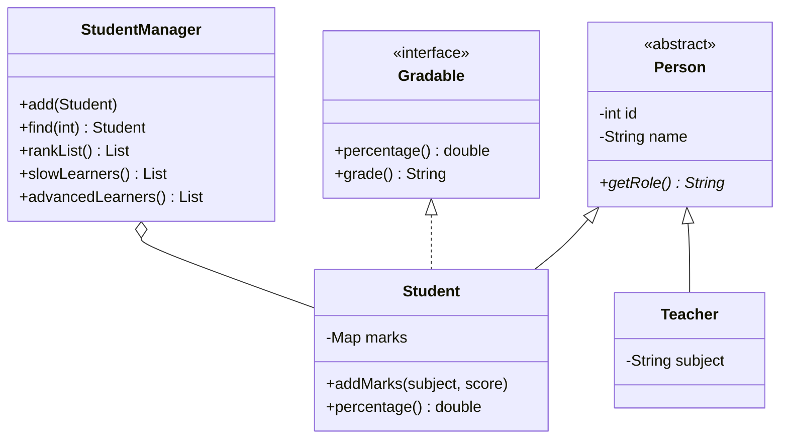

# Student Management System (Java, OOP)

A console application that manages students and teachers, records marks, ranks students, and separates **slow learners (below 40%)** from **advanced learners (above 60%)** so advanced learners can be paired as mentors.

## OOP concepts used

| Concept | Where |
|---|---|
| Abstraction | `Person` (abstract class), `Gradable` (interface) |
| Inheritance | `Student` and `Teacher` extend `Person` |
| Polymorphism | `getRole()` overridden; `Person[]` holds mixed objects |
| Encapsulation | private fields, getters, defensive copy in `Student.getMarks()` |
| Interface default method | `Gradable.grade()` |
| Exception handling | `InvalidMarksException`, `StudentNotFoundException` |
| Collections | `ArrayList`, `HashMap`, `LinkedHashMap`, `Comparator` |
| Multithreading | `ReportGenerator` (ExecutorService, Callable, Future) |

## Class diagram



## How to run

Requires JDK 11 or above.

```bash
cd StudentManagementSystem
javac -d out src/sms/*.java
java -cp out sms.Main
```

In Eclipse: *File > Import > Existing Projects*, or create a Java project and copy the `sms` package into `src`. Run `Main.java`.

## Features

- Add, find and remove students
- Marks validation (0 to 100) using a custom exception
- Rank list sorted by percentage
- Slow learner / advanced learner lists
- Parallel report card generation

## Possible improvements

- Save data to a file or database
- Menu driven input with `Scanner`
- Unit tests with JUnit
